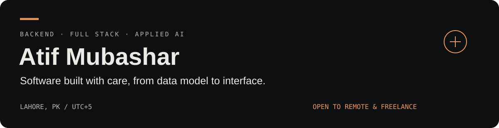

# Full Stack Software Engineer

**Backend-focused engineering · Agentic workflows · Retrieval-augmented generation**

I’m Atif, a software engineer at Prisma Technologies in Lahore with **2 years of professional experience**. I build backend services and React interfaces for production web applications, with a focus on clear APIs, maintainable data models, authentication, and integrations.

Alongside my professional work, I build personal AI applications using Python and TypeScript: document retrieval with cited answers, and support workflows with tool calling, explicit confirmations, and human handoff.

[Portfolio](https://atifmubashar.vercel.app/) · [LinkedIn](https://www.linkedin.com/in/atifmubashar-dev/) · [Email](mailto:atifmubashar353@gmail.com)

## What I bring

| Focus | Experience |
| --- | --- |
| Backend engineering | Node.js, Express.js, REST APIs, request validation, service layers, JWT, RBAC |
| Full stack delivery | React.js, TypeScript, responsive interfaces, frontend and API integration |
| Data and integrations | MongoDB, PostgreSQL, database schemas and indexing, Socket.io, payment gateways, AWS S3 |
| Applied AI | Python, FastAPI, Gemini, LangChain, LangGraph, RAG, FAISS, tool calling |
| Engineering practice | Automated testing, debugging, refactoring, Git/GitHub, Agile/Scrum collaboration |

## Selected work

### [TeamFlow](https://github.com/Atif353/TeamFlow)
**Full stack product engineering** — A Jira-style collaboration platform with workspaces, role-based access, issue tracking, sprints, reports, and rich-text docs. FastAPI and MongoDB backend; React and TypeScript frontend; pytest, Vitest, and Playwright test suites.

### [SupportPilot AI](https://github.com/Atif353/SupportPilot)
**Agentic AI workflows** — A customer support application using LangGraph specialist routing, knowledge retrieval, execution logs, and human handoff. Order changes require explicit confirmation; refund workflows require staff approval. Refunds are simulated.

### [DocMind AI](https://github.com/Atif353/DocMind)
**Document retrieval and Q&A** — PDF question answering with page-level citations, streaming responses, Gemini embeddings, FAISS retrieval, and optional web-search fallback. React → Express gateway → FastAPI AI engine, backed by Supabase PostgreSQL.

### [CAMMS](https://github.com/Atif353/CAMMS)
**Academic full stack project** — Course Activity Management and Monitoring System for instructor activity logging, dashboards, and PDF/Excel reporting. Built with React, Express, PostgreSQL, and Prisma, with JWT authentication and role-based access.

[Explore the portfolio source](https://github.com/Atif353/portfolio) · [View project presentations](https://atifmubashar.vercel.app/work)

## Professional experience

**Software Engineer · Prisma Technologies**  
September 2024–present · Lahore, Pakistan

I contribute across database and API design, backend implementation, frontend integration, debugging, and production support. My work includes authentication and permissions, WebSocket features, payment integrations and webhooks, AWS S3 storage, and query optimization.

Selected professional work includes **Kapasi Glass Network**, **ScholarWheels**, **Afrivalley Marketplace**, and **Examencentrum**. These are employer/client projects; their source code is confidential. [Public experience summaries →](https://atifmubashar.vercel.app/experience)

## Let’s work together

Open to international remote **Full Stack Software Engineer**, **Backend Engineer**, and **AI / Agentic AI Engineer** opportunities, plus selected freelance and contract projects.

For backend systems, full stack applications, or LLM-powered features:  
**[atifmubashar353@gmail.com](mailto:atifmubashar353@gmail.com)** · [Start a conversation](https://atifmubashar.vercel.app/contact)

BS Computer Science · Virtual University of Pakistan · CGPA 3.62/4.00
